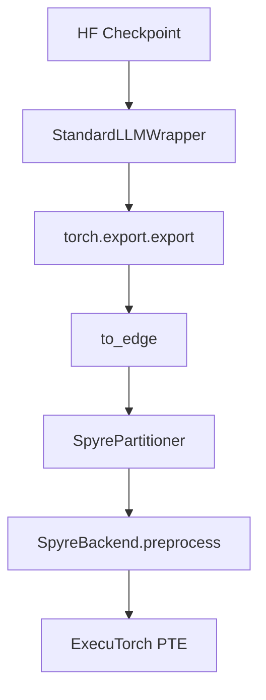
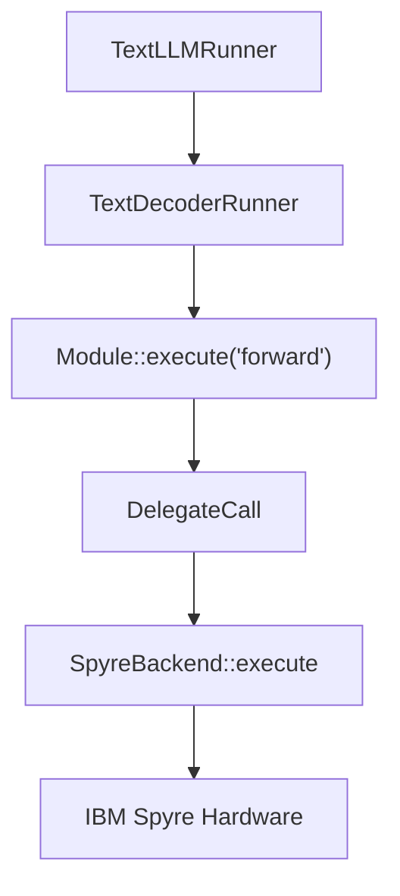
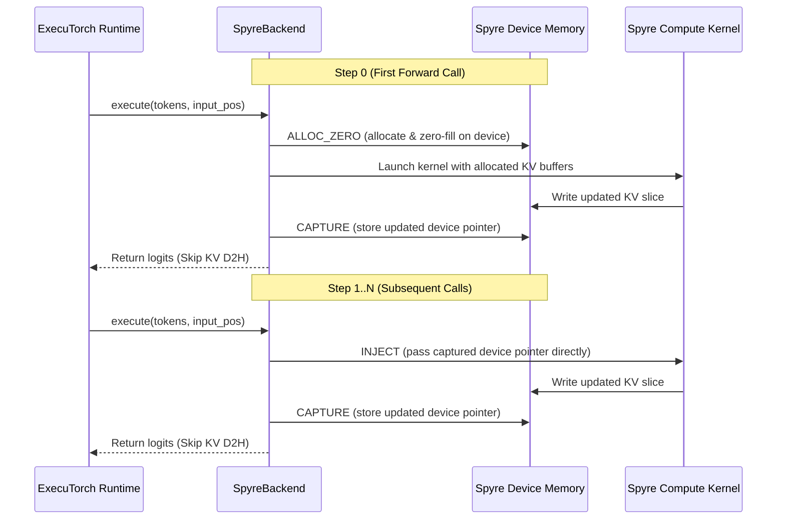

<!--
Copyright 2026 The ExecuTorch-Spyre Authors.
Licensed under the Apache License, Version 2.0.
-->

# HFA decode: design

> This content was moved here from [hfa-decode.md](hfa-decode.md) during the docs reorganization; it is unchanged. To export and run Granite, see [hfa-decode.md](hfa-decode.md); to build the runner, see [setup.md](setup.md).

### 1.4 Standard ExecuTorch LLM Integration

`spyre_hfa_decode_llm.pte` integrates directly with the standard ExecuTorch LLM
infrastructure (`create_text_llm_runner` / `TextLLMRunner`, see
[section 5](#5-standard-executorch-llm-runner-integration)).  It exposes the
standard `(tokens, input_pos) -> logits` signature and the usual constant
methods, so no Spyre-specific host code is needed; `spyre_llm_runner` is only a
thin example application.

---

## 2. Export Flow

The export pipeline converts a Hugging Face model into an ExecuTorch `.pte` exposing the standard 2-input decode signature:

```text
forward(tokens: int64[1, 1], input_pos: int64[1]) -> logits: [1, 1, V]
```



### Pipeline Stages

1. **Model Preparation**: Loaded via `hf_adapters` dispatch (e.g. `prepare_for_spyre`).
2. **[`StandardLLMWrapper`](../executorch/backends/spyre/export_hfa.py:390)**: Encapsulates all decode bookkeeping inside the graph:
   - `position_ids`: Derived in-graph as `input_pos.view(1, 1)` (`int64[1, 1]`).
   - `cache_index`: Sourced directly from `input_pos` (`int64[1]`).
   - `attn_mask`: Gathered from a constant embedding table `_mask_table[C, C]` via `input_pos`, producing `[1, 1, 1, C]`.
   - `KV Caches`: Registered as module buffers (`kv_mode="buffer"`), eliminating host-managed KV parameters.
3. **`torch.export.export`**: Traces the computation graph with static shapes `tokens=[1, 1]` and `input_pos=[1]`.
4. **`to_edge`**: Lowers to ExecuTorch Edge IR and embeds constant metadata methods.
5. **Spyre Partitioning**: [`SpyrePartitioner`](../executorch/backends/spyre/spyre_partitioner.py:1) identifies delegable subgraphs and handles buffer mutation semantics. By default each decoder block becomes its own delegate (see [Partition granularity](#partition-granularity)).
6. **Backend Compilation**: [`SpyreBackend.preprocess`](../executorch/backends/spyre/spyre_backend.py:1) compiles each delegate via `torch-spyre` / `DeepTools`, builds the payload, and produces `spyre_hfa_decode_llm.pte`.

### Partition granularity

The partitioner grows the largest connected supported subgraph, so left alone a
full-depth model collapses into a single delegate and a single compile unit. For
a 40-layer Granite this exceeds the compile timeout. The partitioner therefore
splits each such subgraph at decoder-block boundaries, so every transformer
layer is compiled independently (the same one-layer-at-a-time compilation that
standalone torch-spyre with hf-adapters does). The implementation is
[`spyre_block_partition.py`](../executorch/backends/spyre/spyre_block_partition.py:1).

| Granularity | Result |
|-------------|--------|
| `block` (default) | One delegate per decoder block. The repeated block container (for example `model.layers`) is discovered from `nn_module_stack`; nodes outside any block (embedding, final norm, `lm_head`) join the nearest preceding block. |
| `model` | Legacy behaviour: one delegate per maximal connected subgraph. |

A graph without repeated-block metadata (for example a small non-transformer
model) is partitioned the same way in both modes.

Select the granularity with, in order of precedence:

1. `SpyrePartitioner(granularity="block" | "model")`
2. `export_hfa.py --partition-granularity {block,model}`
3. the `EXECUTORCH_SPYRE_PARTITION_GRANULARITY` environment variable (`block` or `model`)

Any other value is rejected. Only `export_hfa.py` has the flag. The
environment variable applies to every exporter that builds a `SpyrePartitioner`,
including `executorch-spyre-export`:

```bash
# Legacy single-delegate export, for comparison
EXECUTORCH_SPYRE_PARTITION_GRANULARITY=model python executorch/backends/spyre/export_hfa.py \
    --ckpt $CKPT --mode decode --llm-wrapper --seq 128 --stage pte --out-dir $OUT_DIR
```

The partition report printed by `export_hfa.py` shows the granularity in use and
the delegates created.

### Exported Metadata and Constant Methods

The `.pte` binary exposes constant methods queried by ExecuTorch LLM runners:

| Method Name | Return Type | Description |
|---|---|---|
| `get_max_seq_len` | `int64` | Maximum prompt sequence length ($S$) configured at export. |
| `get_max_context_len` | `int64` | Maximum KV cache capacity ($C$) configured at export. |
| `use_kv_cache` | `bool` | Set to `True` for autoregressive KV cache decode. |
| `enable_dynamic_shape`| `bool` | Set to `False` (static shapes used for decode execution). |
| `get_eos_ids` | `list[int64]` | End-Of-Sequence token IDs extracted from tokenizer/checkpoint config. |

---

## 3. Runtime Flow

Runtime execution routes standard ExecuTorch LLM invocations to the Spyre delegate:



### Execution Path

1. **`TextLLMRunner`**: Coordinates prompt prefill, token generation loop, and detokenization.
2. **`TextDecoderRunner`**: Prepares standard inputs (`tokens`, `input_pos`) using `IOManager` and executes `Module::execute("forward")`.
3. **`DelegateCall`**: ExecuTorch invokes `SpyreBackend::execute()` for the delegated subgraph.
4. **`SpyreBackend::execute()`**:
   - Binds input tokens and positions.
   - Manages device-resident KV buffers (`ALLOC_ZERO`, `CAPTURE`, `INJECT`).
   - Launches device kernels (`launchJobPlan`) and waits for completion (`synchronizeDevice`).
   - Copies `logits` to host output buffers while skipping KV cache D2H copies.
5. **Spyre**: Hardware executes compute operations directly on device tensor cores.

---

## 4. KV Cache Handling

The Spyre backend implements a **delegate-owned persistent KV cache** model.

### BUFFER and BUFFER_MUTATION Semantics

- **In-Graph Buffers**: KV caches are registered as model buffers (`BUFFER` input kind).
- **Mutated Buffers**: Cache updates (`index_copy_` / `index_put`) produce `BUFFER_MUTATION` outputs.
- **Delegate Encapsulation**: Buffer mutation mechanics place KV state entirely inside the delegate. Top-level model signatures expose only `(tokens, input_pos) -> logits`.
- **Zero Host Exposure**: KV tensors are not passed as `forward()` arguments and are never returned in host outputs.

### Cache Lifecycle: ALLOC_ZERO -> CAPTURE -> INJECT



1. **`ALLOC_ZERO` (First Call / Step 0)**:
   - On the first call, [`SpyreBackend::execute`](../executorch/backends/spyre/runtime/SpyreBackend.cpp:950) identifies unallocated KV caches.
   - Reads shape and dtype from payload metadata (`input_shapes`, `input_dtypes`).
   - Allocates device memory (`at::zeros`, or `spyre_empty_from_payload_layout` followed by `spyre_fill_tensor(…, 0.0)`) directly on Spyre. No Host-to-Device (H2D) copy occurs.
2. **`CAPTURE` (Every Step)**:
   - After kernel completion, the mutated output tensor at `input_state_out` is captured into `kv_state_cache[i]`.
   - Device-to-Host (D2H) copy is skipped (`kv_out_skip_d2h = true`), eliminating host bus overhead.
3. **`INJECT` (Subsequent Steps)**:
   - On step 1 onward, `kv_state_cache[i]` is bound directly as the device input for the next kernel launch.

### Payload Metadata

Payload headers embed KV tensor properties produced during [`SpyreBackend.preprocess`](../executorch/backends/spyre/spyre_backend.py:404):

- `inputs[i]["kind"]`: Set to `"kv_state"`.
- `inputs[i]["shape"]`: Concrete 4D shape `[1, n_kv_heads, max_context_len, head_dim]`.
- `inputs[i]["dtype"]`: Data format string (e.g. `"float16"` or `"bfloat16"`).
- `inputs[i]["state_out"]`: Mutated buffer output index for capture.

---

## 5. Standard ExecuTorch LLM Runner Integration

The HFA decode `.pte` integrates directly with upstream ExecuTorch LLM runner components:

- **`TextDecoderRunner`**: Drives single-step token execution against `Module::execute("forward")`.
- **`TextTokenGenerator`**: Manages token sampling and stop criteria based on `get_eos_ids`.
- **`TextLLMRunner`**: Top-level text generation interface.
- **`create_text_llm_runner()`**: Upstream factory function for one-line initialization.
- **Standard `IOManager`**: Manages memory planning for `(tokens, input_pos)` inputs and `logits` output.

**No custom decode runner is required.** Standard ExecuTorch applications and tooling work out of the box with Spyre-compiled `.pte` programs.
